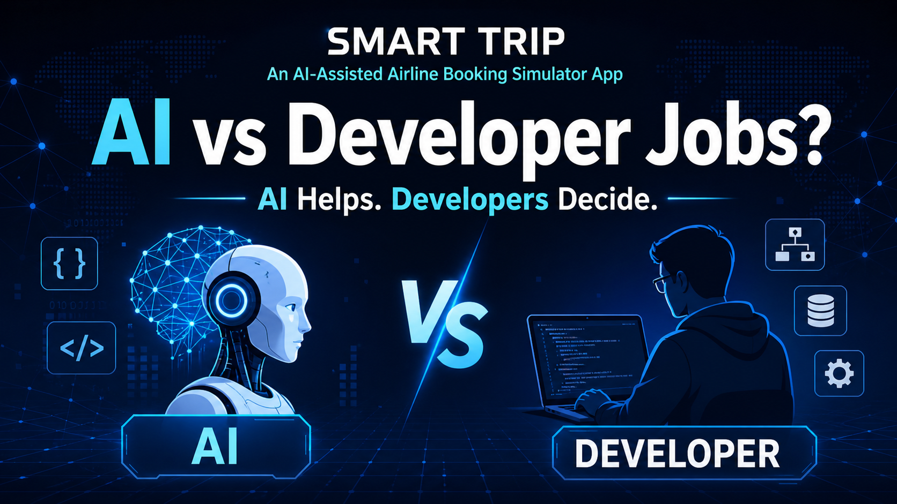
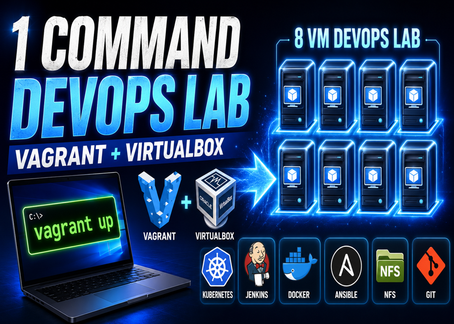

<section class="portfolio-hero">
  
SOFTWARE DEVELOPMENT · DEVOPS · AI

  <h1>Real Projects. Practical Learning.</h1>
  
Welcome to ShivaOps AI — a showcase of hands-on projects where enterprise software experience meets modern engineering, automation, and AI-assisted development.

  

    <a class="portfolio-button primary" href="#featured-projects">Explore projects ↓</a>
    <a class="portfolio-button secondary" href="https://www.youtube.com/@ShivaOps-AI" target="_blank" rel="noopener noreferrer">ShivaOps YouTube ↗</a>
  

</section>

<section class="portfolio-projects" id="featured-projects">
  
MY WORK

  <h2>Featured Projects</h2>
  
A quick introduction to each project. Watch the videos for the complete walkthroughs and demonstrations.

  

    <a class="portfolio-card" href="https://www.youtube.com/playlist?list=PLYkaOC9kXnifZLmJb9NehgmZYqmCEaiQ6" target="_blank" rel="noopener noreferrer" aria-label="Watch Smart Trip project video series on YouTube">
      

        
      

      

        <h3>Smart Trip</h3>
        
An AI-assisted airline booking simulator covering flight search, traveler details, booking, simulated payments, and itineraries.

        Watch the video series ↗
      

    </a>
    <a class="portfolio-card" href="https://youtu.be/xB-PuEIRJpQ" target="_blank" rel="noopener noreferrer" aria-label="Open ShivaOps YouTube videos for the DevOps Lab">
      

        
      

      

        <h3>ShivaOps DevOps Lab</h3>
        
A reproducible seven-VM Ubuntu environment built with Vagrant and VirtualBox, featuring Jenkins, Docker, Ansible, Kubernetes, NFS, Ingress, and MetalLB.

        Explore DevOps videos ↗
      

    </a>
  

  
DevOps Lab source code: <a href="https://github.com/shivaops/devops-lab" target="_blank" rel="noopener noreferrer">View GitHub repository ↗</a>

</section>

<section class="portfolio-footer-promo">
  

    <h2>Watch the full demonstrations</h2>
    
Project details, implementation steps, and practical lessons are covered on the ShivaOps AI YouTube channel.

  

  <a class="portfolio-button primary" href="https://www.youtube.com/@ShivaOps-AI" target="_blank" rel="noopener noreferrer">Visit the channel ↗</a>
</section>
